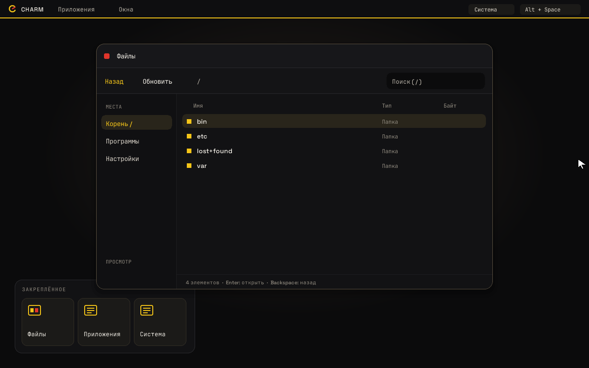
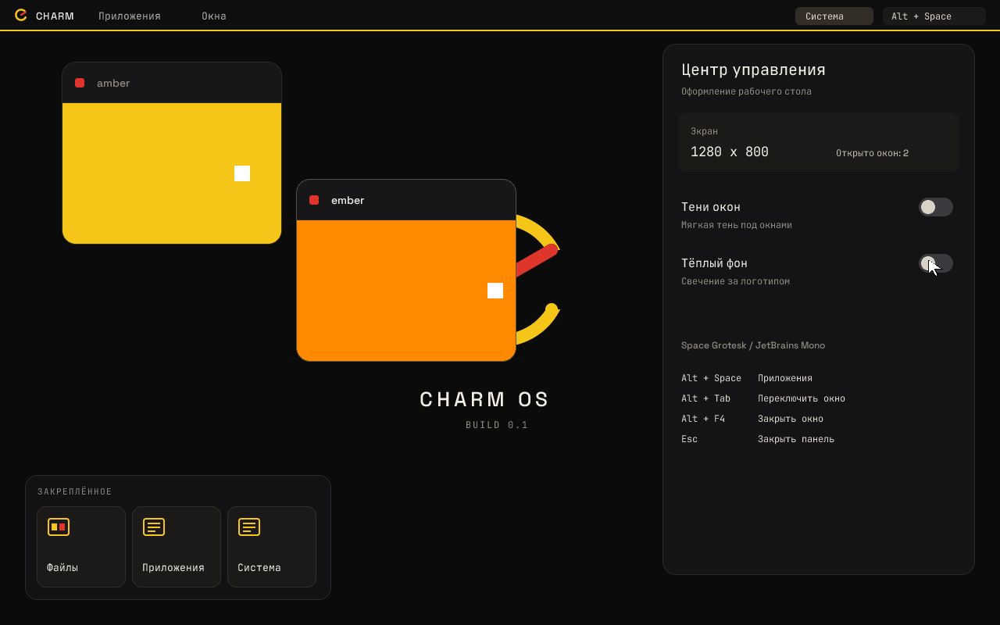
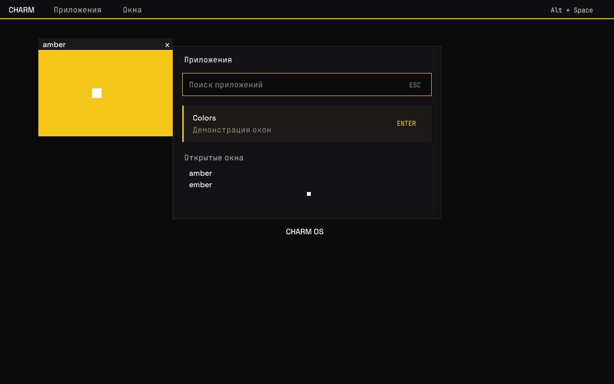
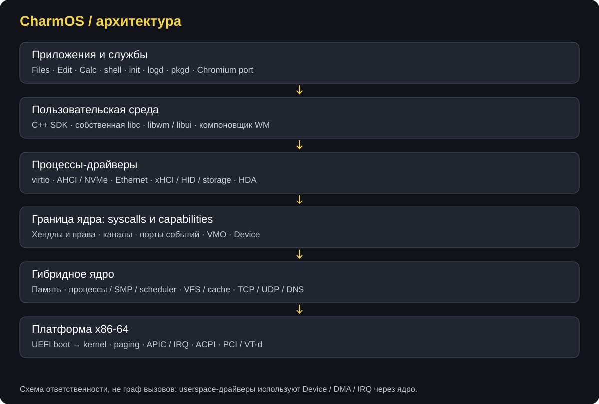
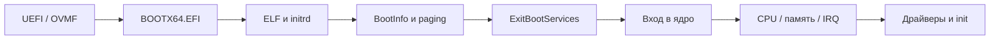
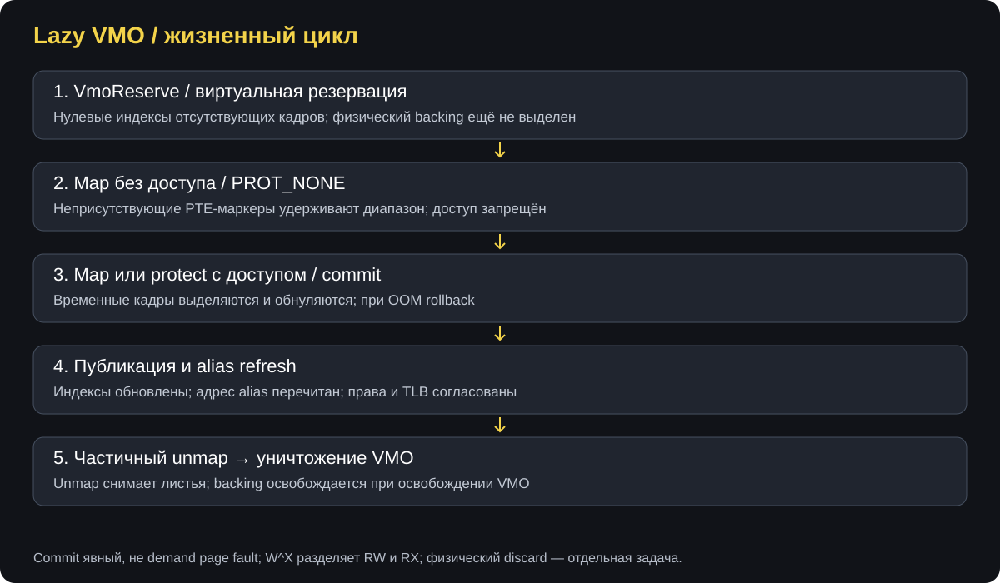
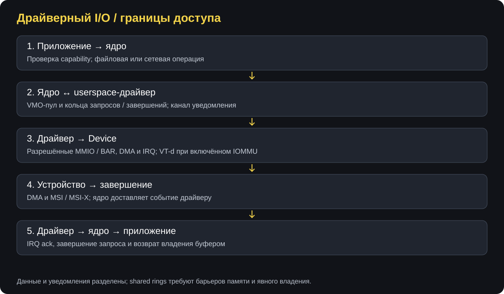
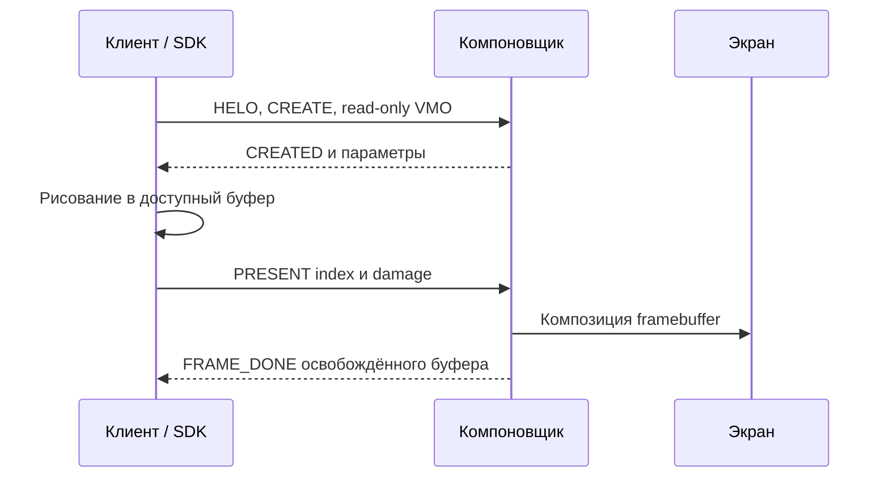
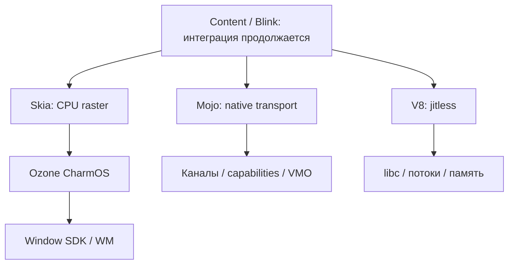

# CharmOS

**Собственная операционная система для x86-64: от UEFI-загрузчика и capability-модели до оконного рабочего стола и нативного порта Chromium.**

Автор / правообладатель: **DarovskoyID**. Основной системный код:
**C++23, C и x86-64 Assembly**. Среда: **WSL2 / Ubuntu, Clang / LLD,
CMake / Ninja, QEMU / OVMF**.

> **Права и доступ.** Репозиторий представлен как техническое портфолио.
> Разрешён просмотр для оценки работы автора. Сборка, запуск, использование,
> изменение и распространение требуют отдельного письменного разрешения,
> кроме применимых прежних лицензий, сторонних условий и прав хостинга.
> Это **не open-source проект**. См. [LICENSE](LICENSE) и
> [пояснения](plans/LICENSING.md).



*Сохранённый кадр файлового менеджера. Снимки скопированы из существующих
артефактов разработки: это не изображения нового запуска и не подтверждение
состояния текущей пересборки.*

## Содержание

- [Проект за минуту](#проект-за-минуту)
- [Статус и границы](#статус-и-границы)
- [Визуальная демонстрация](#визуальная-демонстрация)
- [Общая архитектура](#общая-архитектура)
- [Загрузка и архитектура процессора](#загрузка-и-архитектура-процессора)
- [Управление памятью](#управление-памятью)
- [Процессы, потоки и планирование](#процессы-потоки-и-планирование)
- [Capabilities, IPC и события](#capabilities-ipc-и-события)
- [Драйверы и ввод-вывод](#драйверы-и-ввод-вывод)
- [Файловые системы и хранение](#файловые-системы-и-хранение)
- [Сеть и TLS](#сеть-и-tls)
- [Графика, окна и ввод](#графика-окна-и-ввод)
- [Среда приложений и libc](#среда-приложений-и-libc)
- [Службы, пакеты и системная область](#службы-пакеты-и-системная-область)
- [Нативный порт Chromium](#нативный-порт-chromium)
- [Инженерные методы и проверка](#инженерные-методы-и-проверка)
- [Структура репозитория](#структура-репозитория)
- [Сборка и запуск для автора](#сборка-и-запуск-для-автора)
- [Навигация для технического интервью](#навигация-для-технического-интервью)
- [Дальнейшее развитие](#дальнейшее-развитие)
- [Лицензирование](#лицензирование)

## Проект за минуту

CharmOS исследует полный путь выполнения приложения: загрузка машины,
управление памятью, системные вызовы, выдача прав, IPC, драйверы, файловые и
сетевые операции, отрисовка окна и доставка пользовательского ввода.

Это самостоятельная ОС, а не Linux-дистрибутив и не тема существующего рабочего
стола. Собственные загрузчик, ядро, базовые библиотеки и драйверы сосуществуют
с явно выделенными сторонними компонентами браузерного порта.

| Направление | Что демонстрирует репозиторий |
|---|---|
| Низкоуровневая разработка | UEFI, ELF64, paging, прерывания, APIC, SMP |
| Безопасность | Capabilities, сужение прав, явная передача ресурсов |
| Конкурентность | Планировщик, deadlines, futex, pthread, владение буферами |
| Ввод-вывод | Userspace-драйверы, MMIO, DMA, VT-d, разделяемые кольца |
| Runtime | Собственная libc, статические ELF, C++ runtime, compiler TLS |
| Графика | CPU-компоновщик, TrueType, двойная буферизация, оконный SDK |
| Перенос большого ПО | Chromium: Ozone, Mojo, Skia, V8 и Blink |
| Проверка | Host-тесты, QEMU, serial-протокол, пиксельные проверки, ELF-аудит |

Ниже описаны архитектура и основные методы подсистем. Точные контракты
отдельных функций, структур и ограничений находятся в [docs/abi](docs/abi).

## Статус и границы

Подготовлено **2026-11-09** по исходникам и журналам проекта. Сборка и тесты
при подготовке README не запускались. Упоминание успешной проверки означает
**ранее зафиксированный результат**, а не новую проверку рабочего дерева.

| Область | Состояние и оговорки |
|---|---|
| Фундамент | M0–M8.5 отмечены закрытыми в roadmap; M9a закрыта по инструкции проекта |
| Рабочий стол | M10 продолжается; окна, приложения, USB и звук имеют реализации и QEMU-сценарии |
| Оборудование | M9b и USB на реальном ПК требуют отдельной проверки |
| Память | ABI 1.22: W^X, PROT_NONE, lazy VMO, partial unmap; физический discard ограничен |
| V8 | Ранее проверены JS, GC, Dispose и завершение потоков; interpreter-only / jitless |
| Blink | HANDOFF фиксирует компиляцию blink_port 2026-11-07; это не готовый браузер |
| Content / browser | Активное портирование; текущая пересборка здесь не считается завершённой |
| GPU / Vulkan / ИИ / игры | Последующие фазы, не готовые возможности |

Источники: [ROADMAP](plans/ROADMAP.md), [HANDOFF](HANDOFF.md),
[задачи браузера](plans/BROWSER-TODO.md), [ревью](BROWSER-REVIEW.md).
В документах сохраняется история: позднее уточнение может заменять ранний
статус. В частности, draft lazy VMO не заменяет финальный partial unmap ABI 1.22.

## Визуальная демонстрация

### Рабочий стол и настройки



Центр управления, оформление окон и программно нарисованные поверхности.
Скриншот показывает конкретный сохранённый этап интерфейса.

### Лаунчер



Более ранний сохранённый кадр: поиск, список приложений и открытые окна.
Версии оформления на снимках различаются. Архитектурные иллюстрации далее —
схемы, а не скриншоты; SVG доступны без внешнего сервиса диаграмм.

## Общая архитектура



Используется **гибридное ядро**. Планирование, память, capabilities, ФС и
TCP/IP находятся в ядре. Драйверы, компоновщик, службы и приложения —
отдельные пользовательские процессы.

Такое разделение оставляет файловые и сетевые операции внутри ядра, но делает
взаимодействие с драйверами явным: устройство, разрешённые буферы, сообщения и
события. Оно не гарантирует безвредность любого сбоя: ядро, протоколы и IOMMU
остаются частью доверенной базы.

| Слой | Ответственность | Где читать |
|---|---|---|
| UEFI | ELF, карта памяти, GOP, ExitBootServices | [boot/uefi](boot/uefi), [boot ABI](docs/abi/boot.md) |
| x86-64 | GDT/TSS, IDT, paging, APIC, context switch | [arch/x86_64](arch/x86_64) |
| Ядро | Процессы, память, IPC, ФС, сеть | [kernel](kernel) |
| Драйверы | MMIO, IRQ, DMA и очереди устройств | [user/drivers](user/drivers) |
| Runtime / SDK | Syscalls, libc, владение ресурсами, окна | [rt](user/rt), [libc](user/libc), [libwm](user/libwm) |
| Приложения | Init, shell, журнал, пакеты и GUI | [init](user/init), [bin](user/bin) |
| Внешние движки | Адаптация Chromium и зависимостей | [tools/chromium](tools/chromium) |

Принцип границы — контракт перед реализацией: ABI задаёт раскладку структур,
версии, права, ошибки и владение ресурсами.

## Загрузка и архитектура процессора



### Загрузчик

Собственный UEFI loader читает ELF64 и сегменты `PT_LOAD`, выделяет страницы,
копирует содержимое, обнуляет `.bss` и задаёт права по флагам сегментов.
Writable + executable сегменты отклоняются.

Версионированный `BootInfo` передаёт карту памяти, GOP framebuffer, RSDP,
параметры запуска и модули. Ядро не использует Boot Services после
`ExitBootServices`. Размеры и смещения структур фиксируются явно.

### Машинный слой

- Целевая архитектура — x86-64 long mode; мультиархитектурность не заявляется.
- Higher-half kernel и HHDM разделяют виртуальное ядро и прямой доступ к физической памяти.
- Используются четырёхуровневые таблицы страниц, без LA57.
- GDT/TSS и IDT задают сегменты, стеки привилегий и исключения.
- Local APIC обеспечивает таймерное вытеснение; запуск AP поддерживает SMP.
- ACPI обнаруживает платформу; в `lib/acpi` имеется собственный AML-код.
- HPET, PM timer и platform-слой обеспечивают временную инфраструктуру.

Код: [UEFI main](boot/uefi/main.cpp), [kernel main](kernel/core/main.cpp),
[машинный слой](arch/x86_64/src), [ACPI](kernel/acpi), [AML](lib/acpi).

## Управление памятью

### Фреймы и куча

Физический аллокатор использует bitmap фреймов поверх карты памяти загрузчика.
Поддерживаются непрерывные диапазоны, выравнивание и выделение ниже физического
предела, например для запуска AP.

Куча построена на **boundary tags**, двусвязном free list и **first-fit**.
Освобождение объединяет соседние свободные блоки. Выравнивание — 16 байт;
область растёт через callback отображения дополнительных страниц. Ошибки
выделения возвращаются явно.

Код: [PMM](kernel/mm/pmm.cpp), [bitmap](lib/mm/src/frame_bitmap.cpp),
[heap](lib/mm/src/heap.cpp), [AddressSpace](kernel/mm/address_space.cpp).

### VMO и защита

VMO — объект памяти, доступный через capability. Несколько отображений могут
ссылаться на один объект с отдельными правами доступа.



| Операция | Метод и ограничение |
|---|---|
| `VmoCreate` | Backing выделяется заранее |
| `VmoReserve` | Индексы ещё не выделенных кадров остаются нулевыми |
| Map без доступа | Неприсутствующие PTE-маркеры удерживают виртуальный диапазон |
| Commit | Недостающие кадры выделяются и обнуляются перед публикацией |
| OOM | Временные кадры откатываются; VMO не меняется частично |
| Alias refresh | Физический адрес перечитывается из VMO при восстановлении доступа |
| `VmoProtect` | Защита меняется постранично с пределом исходных capability-прав |
| `VmoUnmapRange` | Листья диапазона снимаются, backing остаётся у VMO |

**W^X** запрещает одновременно writable и executable отображение.
Запись кода и исполнение разделены сменой защиты RW → RX. Изменения требуют
согласования TLB на CPU.

Lazy VMO не означает demand paging через page fault: commit выполняется
явной операцией map/protect. `MADV_DONTNEED` пока не гарантирует физическое
освобождение или zero-on-recommit. Полный POSIX mmap и произвольный `MAP_FIXED`
не заявляются.

Контракты: [lazy VMO](docs/abi/lazy-vmo.md), [W^X](docs/abi/executable-memory.md),
[PROT_NONE](docs/abi/inaccessible-memory.md), [mapping](docs/abi/libc-mapping.md).

## Процессы, потоки и планирование

### Запуск без fork

Процесс создаётся из файлового хендла ELF. Ресурсы выдаются стартовым
сообщением: роли `Root`, `Cwd`, `Console`, `Net`, `Job`, `Wm` и другие.
Корень ФС, сеть и устройства не наследуются автоматически.

Совместимые форматы `strt` и `str2` различаются ёмкостью стартовых ролей.
Capability `Process` позволяет ждать завершения, получать результат и
завершать процесс в пределах прав. Закрытие хендла процесс не убивает.

### Очереди и ожидания

На каждом CPU — отдельные очереди приоритетов и idle-поток. Выбирается
высший готовый уровень, внутри него FIFO / round-robin. Вытеснение связано
с таймером Local APIC. Это не CFS и не обещание hard real-time.

Ожидания имеют абсолютные сроки, пробуждение и прерывание. Ядро использует
spinlock, mutex и wait-примитивы; ранги блокировок проверяют порядок захвата.
Пользовательский слой предоставляет pthread/futex, thread-specific storage
и механизмы завершения потоков.

`Job` задаёт иерархию и ограничения ресурсов/приоритетов. Процессные операции
опираются на capability, а не на свободное открытие чужого процесса по PID.

Код: [proc](kernel/proc), [sched](kernel/sched/sched.cpp), [sync](kernel/sync),
[SMP](kernel/smp), [pthread](user/libc/src/pthread.cpp).
Документ: [process ABI](docs/abi/process.md).

## Capabilities, IPC и события

### Права

Хендл — запись в таблице процесса: объект плюс маска разрешений. Поколение
слота защищает от использования старого значения после переиспользования.
Дублирование только сужает права. Передача требует `Transfer`, копирование —
`Duplicate`; чтение, запись, отображение и исполнение проверяются отдельно.
Происхождение производных capabilities позволяет выполнять отзыв.

### Сообщения

Канал — два связанных конца. Сообщение несёт байты и хендлы. Успешная отправка
перемещает передаваемые хендлы; для сохранения доступа нужна отдельная копия.

```mermaid
sequenceDiagram
    participant A as Процесс A
    participant K as Ядро / канал
    participant B as Процесс B
    A->>K: Сообщение и capability с Transfer
    K->>K: Проверка прав и ресурсов
    K-->>A: Успех; переданный хендл удалён у A
    B->>K: Чтение
    K-->>B: Байты и хендл в таблице B
```

Очереди ограничены: заполнение даёт backpressure (`WouldBlock`), закрытие
партнёра — `PeerClosed`. Малый буфер не должен поглощать сообщение.
Порты объединяют IRQ, каналы и другие события; one-shot подписки перевзводятся.
VMO используются для крупных разделяемых буферов.

Код: [IPC](kernel/ipc/ipc.cpp), [таблица хендлов](lib/cap/src/handle_table.cpp).
Документы: [ipc](docs/abi/ipc.md), [watch](docs/abi/object-watch.md),
[channel control](docs/abi/channel-control.md).

## Драйверы и ввод-вывод



Ядро перечисляет PCI, сопоставляет устройства с TOML-манифестами и запускает
процессы-драйверы. `Device` даёт контролируемый доступ к BAR, IRQ и DMA.

### Аппаратная граница

- MMIO имеет отдельные свойства кэширования.
- DMA выдаётся через интерфейс устройства; VT-d ограничивает видимость памяти
  IOMMU-доменом при использовании соответствующего профиля.
- MSI/MSI-X доставляются как события; код userspace-драйвера не исполняется
  прямо в обработчике прерывания ядра.
- IRQ подтверждается драйвером перед следующим уведомлением.
- Shared rings используют индексы, явное владение и барьеры памяти.

| Класс | Реализации в дереве | Назначение |
|---|---|---|
| Block | virtio-blk, AHCI, NVMe | Дисковые запросы и завершения |
| Ethernet | virtio-net, e1000, rtl8139 | Кадры и RX/TX-пулы |
| USB | xHCI | Command/event rings, HID, BOT/SCSI |
| Audio | HDA | Ограниченный PCM DMA-вывод |
| Учебный | edu | Проверка userspace driver mechanics |

Наличие исходника не обещает поддержку любого реального контроллера.
USB на реальном ПК и внешние хабы имеют отдельные ограничения.

Контракты: [driver](docs/abi/driver.md), [block](docs/abi/block.md),
[net rings](docs/abi/net.md), [input driver](docs/abi/input-driver.md).
Профили: [DRIVERS](plans/DRIVERS.md).

## Файловые системы и хранение

Путь запроса проходит драйвер, блочный слой, кэш и ФС. GPT задаёт разделы;
FAT32/ext2 реализованы в `lib/fs`, объектный доступ ядра — через VFS.

Путь отсчитывается от capability каталога. Хендл даёт поддерево, а не весь
диск; исходный контракт запрещает `..` и не обещает symlink. Libc адаптирует
свои правила путей к привычным файловым функциям.

Нативный API использует явные смещения, подобно `pread/pwrite`. Обычную
FD-позицию ведёт libc. `file_sync` должен дойти до flush устройства.
Есть открытие, чтение, запись, resize, перечисление, удаление и sync.
FAT32/ext2 не означают поддержку ext4, журналирования или всех Unix-метаданных.

Код: [VFS](kernel/fs/vfs.cpp), [cache](kernel/fs/cache.cpp), [block](kernel/block),
[FAT32](lib/fs/src/fat32.cpp), [ext2](lib/fs/src/ext2.cpp).
Контракты: [fs](docs/abi/fs.md), [identity](docs/abi/fs-identity.md).

## Сеть и TLS

Ethernet-драйверы передают кадры через VMO-пул и RX/TX-кольца. TCP/IP находится
в ядре, BSD-подобная libc и C++ SDK предоставляют интерфейс приложениям.
Преобразования IPv4/IPv6 строк отделены от транспорта: IPv6 parser не означает
готовность IPv6-сокетов ядра.

| Уровень | Метод |
|---|---|
| Ethernet | Userspace-драйверы и shared rings |
| TCP / UDP | Собственный kernel stack и сокетные объекты |
| DNS | Net capability и настоящий syscall, без хостовой подмены |
| SDK | NetworkInfo, resolve_ipv4 и явные статусы |
| Libc | Документированное socket/address/resolver-подмножество |
| TLS | BoringSSL memory BIO поверх нативного TCP |

Ранее TLS-проверки включали TLS 1.2/1.3, ответы контролируемого сервера и
отказы при неверном hostname, доверии или сроке сертификата. Это не доказывает
готовность Chromium net adapter. Асинхронные сокеты и options оцениваются по
контракту и тестам, а не по наличию заголовков. Статический обзор выявил
отдельную задачу корректного неблокирующего send.

Код: [kernel/net](kernel/net), [socket libc](user/libc/src/socket.cpp),
[SDK](user/rt/include/charm/network.hpp). Документы: [socket](docs/abi/socket.md),
[libc network](docs/abi/libc-network.md), [TLS](docs/abi/tls-runtime.md).

## Графика, окна и ввод

### Композиция

GOP предоставляет framebuffer. Процесс `wm` собирает поверхности приложений
в итоговый кадр. Damage tracking описывает изменённые области. Это software
rendering, не GPU-ускорение.

Собственный UI и TrueType-код рисуют текст и элементы рабочего стола.
Space Grotesk и JetBrains Mono — сторонние шрифтовые файлы под OFL.

### Владение буферами

Клиент создаёт два VMO и передаёт компоновщику read-only capabilities.
После `PRESENT` буфер занят до соответствующего `FRAME_DONE`: SDK не должен
разрешать перезапись ещё используемой поверхности.



### Управляемые окна

WM v3 добавляет title, bounds, видимость, активацию и поколения. Resize —
согласованная замена пары VMO: ресурсы живут до `CONFIGURED`; отказ сохраняет
старое окно. Успех отправки запроса не равен принятию нового размера.

PS/2 и USB HID обеспечивают клавиатуру/мышь, фокус, движение и wheel.
Hotkeys: Alt+Space, Alt+Tab, Alt+F4. Функции определяются объявленными
capabilities, а не одним названием версии. В дереве — файловый менеджер,
редактор, калькулятор и демонстрации; часть системного UI находится внутри WM.

Код: [wm](user/bin/wm/wm.cpp), [libwm](user/libwm), [libui](user/libui),
[font](lib/font), [PS/2](kernel/input/ps2.cpp). Документы: [v2](docs/abi/wm.md),
[v3](docs/abi/wm-v3.md), [UI progress](plans/UI-PROGRESS.md).

## Среда приложений и libc

Приложения — нативные статические ELF. Runtime предоставляет точку входа,
syscalls, аргументы, окружение и стартовые capabilities. Это не Linux ABI:
совпадение имени POSIX-функции не позволяет запустить любой Linux ELF.

| Часть | Назначение |
|---|---|
| `user/rt` | Старт, syscall wrappers, C++ SDK |
| `user/libc` | Строки, память, stdio, FD, pthread, время, сеть |
| C++ runtime | Поддержка C++-потребителей в пределах документированного контракта |
| Compiler TLS | Эмулируемое TLS и thread-local destructors |
| Ownership SDK | Владеющие и borrowed handles, cleanup через RAII |
| Event loop | Ports, object watch, poll и FD-наблюдатели для MessagePump |

Ядро собирается без exceptions/RTTI, ошибки выражаются `Result`/`Status`.
Это правило ядра не переносится автоматически на все внешние user-компоненты.

Часть API ограничена или возвращает `ENOTSUP`. Документированные заглушки не
выдаются за полную реализацию: UTC-only календарь — не timezone database,
а наличие mmap — не весь POSIX. Libc продолжает развиваться.

Документы: [runtime](docs/abi/libc-runtime.md), [FD](docs/abi/libc-fd.md),
[threads](docs/abi/libc-threads.md), [semaphores](docs/abi/libc-semaphores.md),
[compiler TLS](docs/abi/compiler-tls.md), [C++](docs/abi/cxx-runtime.md),
[SDK](docs/abi/application-sdk.md).

## Службы, пакеты и системная область

`init` запускает службы. В дереве имеются shell, `logd`, `pkgd` и HTTP-сервер.
Стартовые роли определяют доступные ресурсы.

### Пакеты и доверие

`.cpk` содержит заголовок, таблицу, TOML-манифест, файлы и подпись. SHA-512
связывает содержимое с таблицей; подписанная таблица позволяет проверять
исполняемый файл при запуске. Есть Ed25519-код и инструменты подготовки пакетов.

Магазинные и сторонние пакеты различаются политикой доверия и подтверждением
установки. Это политика package manager, не обещание готового публичного магазина.

### Изолированное хранение

System Area — отдельный GPT-раздел ext2 вне обычного корня. Capability
`System` выдаётся init и передаётся `pkgd`; без него обычное приложение
не получает путь к области.

Документированное шифрование — AES-256-XTS и TPM2 sealing с PCR 0–7.
XTS не аутентифицирует сектора: SHA-512 проверки заголовка нельзя выдавать
за общий MAC данных. Без TPM область по принятому контракту не монтируется.

### Аудио

Audio-capability открывает соединение с HDA-драйвером. Базовый формат —
PCM 48 кГц, stereo, signed 16-bit little-endian. Приложение не получает MMIO
и DMA. Первая версия не обещает mixer, capture, поканальную громкость или gapless.

Документы: [package](docs/abi/package.md), [pkgd](docs/abi/pkg.md),
[crypt](docs/abi/sysarea-crypt.md), [audio](docs/abi/audio.md).

## Нативный порт Chromium

Цель — работа движка непосредственно поверх CharmOS, собственной libc и
capability API. Используются Generic ELF toolchain и отдельная идентичность
платформы; это не запуск Linux-браузера в совместимом окружении.



| Компонент | Работа и граница |
|---|---|
| Base | Примитивы платформы, процессы, время, JSON, файлы и потоки |
| Skia | Растровый вывод в настоящее окно ОС |
| Ozone | PlatformWindow, Screen, SurfaceFactory, ввод, resize, canvas |
| Mojo | Capability transport, shared buffers, bootstrap дочерних процессов |
| V8 | JavaScript jitless; ранее проверены GC и полный shutdown |
| Blink | Зафиксирована компиляция blink_port; исполнение требует интеграции |
| Content shell | Цель добавлена, активное портирование; готовность не утверждается |
| Browser UI / net | Навигация, вкладки, сеть и общая интеграция остаются задачами |

### Jitless и профиль без Rust

V8 проверялся с `--jitless`: upstream RWX code range не появляется от
наличия RW → RX при политике W^X. JIT/PKU требует отдельного решения.

Проверяемый GN-граф не содержит Rust-зависимостей: применены C++-замены и
отключения функций. Это не полный перенос всех Rust-компонентов. XML
переведён на C++/libxml2, часть multimedia/ML/GPU выключена. IFT patching,
отдельная ECDSA verification и signed web bundle parsing не заявляются
перенесёнными только по факту компиляции.

Большие сообщения Mojo, поколения буферов, GC/Dispose и откаты ошибок —
самостоятельные контракты. Выполнение JS не доказывает HTML/CSS/DOM и браузер.

Ссылки: [platform](tools/chromium/platform), [Ozone](tools/chromium/ozone),
[план](plans/CHROMIUM-PORT.md), [review](BROWSER-REVIEW.md),
[Mojo ABI](docs/abi/chromium-mojo.md), [Ozone ABI](docs/abi/chromium-ozone.md),
[V8 ABI](docs/abi/v8-runtime.md).

## Инженерные методы и проверка

### Методы

| Метод | Назначение | Пример |
|---|---|---|
| Версии ABI | Совместимость компонентов | `strt`/`str2`, новые syscalls, WM v2/v3 |
| `static_assert` | Проверка shared/hardware layout | BootInfo, wire messages, ring records |
| `Result` / `Status` | Явная ошибка | Аллокация, системные операции |
| RAII / borrowed views | Управление временем жизни | Handles, окна, process views |
| Поколения | Защита от устаревшего состояния | Handles и resize |
| Prepare → publish | Отказ без полусостояния | VMO commit, WM CONFIGURE |
| Ограниченные очереди | Backpressure и ограничение памяти | IPC, Mojo и кольца |
| Deadlines | Ограниченные ожидания | Каналы, порты и process waits |
| Спецификация перед кодом | Проверяемая аппаратура | PCI, xHCI, HDA, DMA |

### Уровни проверки

1. **Host:** аллокаторы, ELF, ACPI, ФС, capabilities, crypto, шрифты и кольца без загрузки ОС.
2. **QEMU:** запуск системы, последовательности serial-строк и код выхода.
3. **GUI:** сценарный ввод, снимки и проверки пикселей.
4. **Runtime gates:** интеграция движка, ошибки и корректное завершение.
5. **Build audits:** native ELF, зависимости линковки и GN-граф.

Harness обычно ожидает QEMU exit code **33** через `isa-debug-exit`; сценарий
может задать иной код. `.expected` — строки по порядку, `.cmdline` — параметры,
`.timeout` — лимит, `.keys` — ввод и проверки экрана.

Каталоги: [host](tests/host), [QEMU](tests/qemu), [harness](tools/test.sh).
Конфигурация [.github](.github) не является доказательством текущего зелёного CI.

### Открытые вопросы статического обзора

Перед проверенной runtime-публикацией нужно закрыть найденные проблемы `%f`
с большой точностью, неблокирующей TCP-записи, ошибок `dprintf`, проверки
`fdopen` и результата `fflush(NULL)`. README не объявляет их исправленными;
пересборка сама по себе не подтверждает устранение дефектов.

## Структура репозитория

```text
CharmOS/
├── boot/uefi/          UEFI loader
├── arch/x86_64/        CPU, paging, IRQ, assembly
├── kernel/             ядро, процессы, ФС, сеть, IPC
├── include/abi/        общие структуры и syscalls
├── lib/                алгоритмы, парсеры и общие подсистемы
├── user/
│   ├── rt/             runtime / SDK
│   ├── libc/           собственная libc
│   ├── libwm/          клиент окон
│   ├── libui/          программный UI
│   ├── drivers/        userspace drivers
│   ├── init/           старт служб
│   ├── bin/            программы и службы
│   └── tests/          гостевые тесты
├── tools/              образы, QEMU, подпись, порт Chromium
├── tests/host/         тесты на хосте
├── tests/qemu/         сценарии полной ОС
├── assets/fonts/       шрифты и OFL
├── docs/abi/           контракты
├── docs/images/        схемы и сохранённые снимки
├── docs/specs/         спецификации
├── plans/              roadmap и решения
├── LICENSE             закрытые условия оценки
└── CMakeLists.txt      uefi/kernel/user/host superbuild
```

Размещение: [LAYOUT](plans/LAYOUT.md). `build/` исключён из Git;
сгенерированные бинарники не являются содержимым README.

## Сборка и запуск для автора

Раздел предназначен автору и лицам с отдельным разрешением. Инструкции не
расширяют лицензию. Не запускать во время идущей пересборки. Эти команды
не выполнялись при подготовке документации.

Среда WSL2 Ubuntu: Clang, LLD, LLVM, CMake, Ninja, QEMU x86, OVMF, GDB,
swtpm. Первичная установка меняет системные пакеты и проводится отдельно.

```bash
# Первичная настройка разрешённой среды:
bash tools/setup-wsl.sh

# Четыре подпроекта с отдельными toolchain:
cmake -S . -B build -G Ninja
ninja -C build

# QEMU / отладка:
tools/run.sh
tools/run.sh --gdb

# Проверки:
ctest --test-dir build/host --output-on-failure
tools/test.sh m8 60 libc
```

Из Windows команды направляются в WSL:

```powershell
wsl -d Ubuntu --cd /mnt/a/CharmOS -- bash tools/run.sh
```

Суперсборка разделяет UEFI PE32+, kernel ELF, user ELF и host tools.
У Chromium собственные GN-граф, подготовка и зависимости: обычный Ninja
суперсборки не является обещанием собрать браузер целиком.

Отладка: serial, исключения с регистрами/бэктрейсом, QEMU/GDB и сценарные логи.
Наличие бинарника не заменяет завершённую сборку и соответствующий тест.

## Навигация для технического интервью

| Тема | Точка входа | Вопрос |
|---|---|---|
| Загрузка | [boot ABI](docs/abi/boot.md) | Почему физические адреса и явные размеры? |
| Безопасность | [IPC](kernel/ipc/ipc.cpp) | Как сужаются права и отзываются потомки? |
| OOM | [lazy VMO](docs/abi/lazy-vmo.md) | Когда commit становится видимым alias? |
| Планирование | [sched](kernel/sched/sched.cpp) | Как совмещаются приоритеты и round-robin? |
| DMA | [net rings](docs/abi/net.md) | Кто владеет буфером в каждый момент? |
| GUI | [WM v3](docs/abi/wm-v3.md) | Что происходит при отказе resize? |
| Runtime port | [platform](docs/abi/chromium-platform.md) | Где заканчивается POSIX-подмножество? |
| Lifecycle | [V8](docs/abi/v8-runtime.md) | Чем GC/Dispose/join сильнее запуска JS? |
| Проверяемость | [harness](tools/test.sh) | Как исключить ложный PASS? |

Проект показывает решения, ограничения и ход разработки. Сторонние движки,
шрифты и зависимости не приписываются автору ОС.

## Дальнейшее развитие

- Content-порт и проверка настоящего HTML/CSS/DOM.
- Chromium net adapter, навигация и вкладки.
- Физический discard committed-страниц и развитие адресного пространства.
- Отдельное решение JIT/PKU с сохранением выбранной модели защиты.
- Доработка рабочего стола и испытания на реальном оборудовании.
- M11–M14: совместимость драйверов, GPU/Vulkan, ИИ/игры и опциональный NDIS.

Критерии задаёт [ROADMAP](plans/ROADMAP.md). Это планы, не готовые возможности.

## Лицензирование

Собственные материалы: **CharmOS Proprietary Evaluation License 1.0**.
Разрешён просмотр для технической оценки, остальные права сохранены с
исключениями применимого закона и лицензии. [Текст](LICENSE),
[пояснения](plans/LICENSING.md).

**История MIT сохраняется:** новые условия не отзывают ранее выданные права
на материалы под MIT. GitHub сохраняет права просмотра и in-service forks
по своим условиям. Закрытая лицензия не делает публичный код секретным.

Сторонние условия: [шрифты](assets/fonts/README.md),
[Chromium](tools/chromium/licenses/README.md), [спецификации](docs/specs/README.md).
Перечень не заменяет полный аудит распространяемой сборки.

За разрешением на сборку, запуск или использование обращайтесь к владельцу
через профиль репозитория. Оценка кандидата не предоставляет работодателю
прав включать код в свои продукты.
